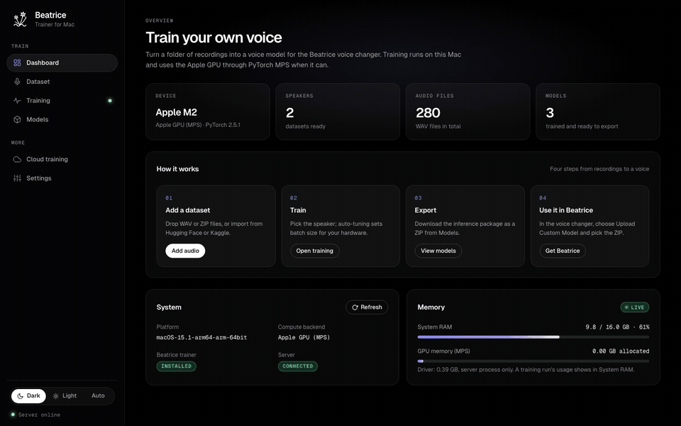
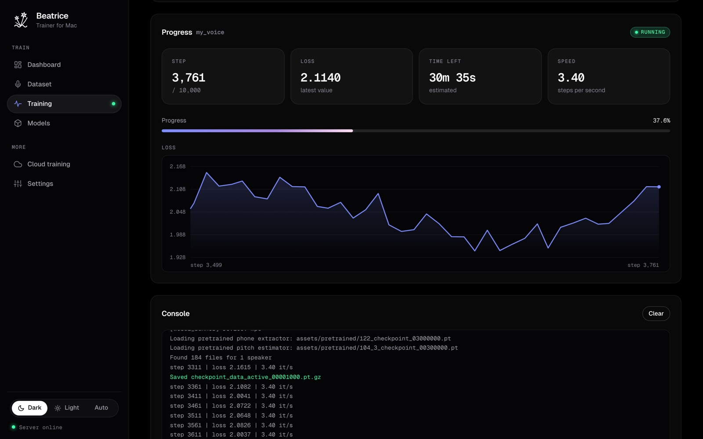
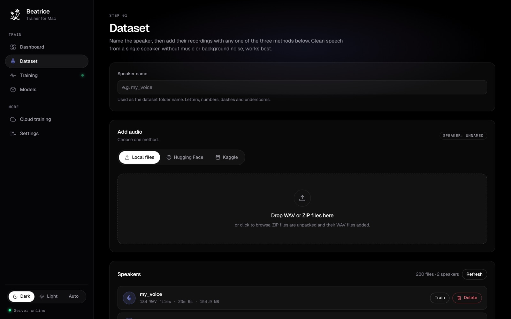
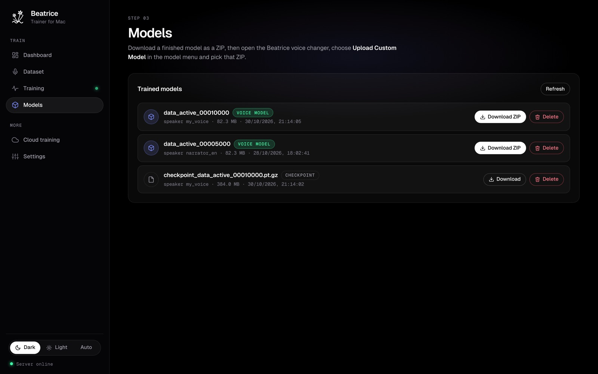
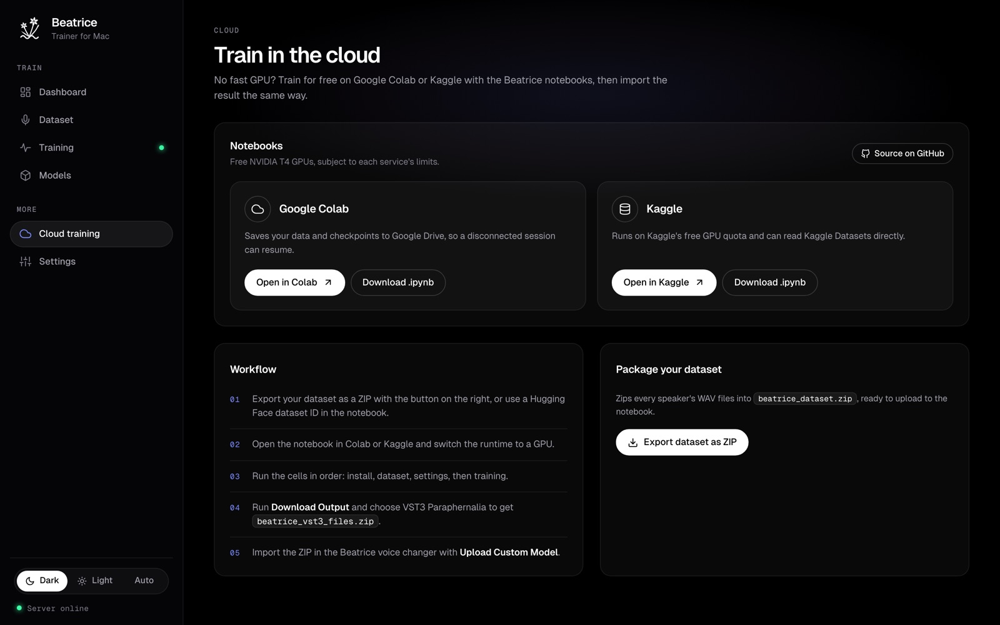
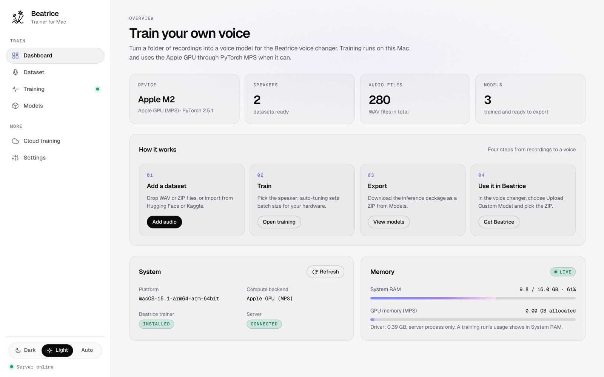
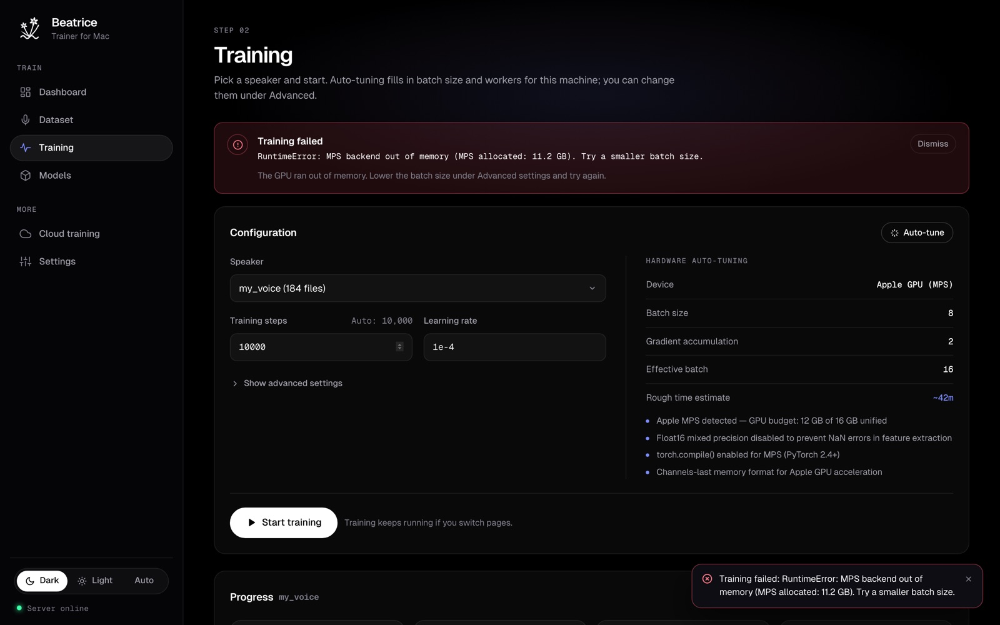
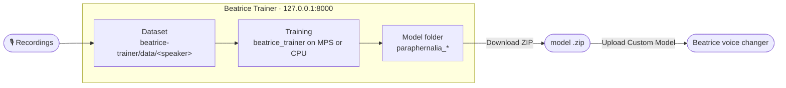

<div align="center">


# Beatrice Trainer for Mac

**Train your own voice for the Beatrice voice changer, on your Mac.**<br/>
Add recordings of one speaker, press Start, then import the finished model into Beatrice with **Upload Custom Model**.

[](https://github.com/Project-Beatrice-V2/Beatrice-trainer-macos/archive/refs/heads/main.zip)
[](https://project-beatrice.vercel.app)
[](https://github.com/Project-Beatrice-V2)


[Website](https://project-beatrice.vercel.app) · [Beatrice for Mac](https://github.com/satiricalguru/Beatrice-voicechanger-mac) · [Beatrice for Windows](https://github.com/satiricalguru/Beatrice-voicechanger-windows) · [Trainer for Windows](https://github.com/Project-Beatrice-V2/Beatrice-trainer-windows) · [Report a bug](https://github.com/Project-Beatrice-V2/Beatrice-trainer-macos/issues/new)

<br/>



</div>

---

## ✨ Why Beatrice Trainer

- 🎙️ **A real Beatrice model of your voice.** It runs the upstream [Beatrice trainer](https://huggingface.co/fierce-cats/beatrice-trainer) on your recordings. There is no fake or "demo" training mode: if the trainer can't run, you see why.
- 🍎 **Uses your Mac's GPU.** On Apple Silicon it trains through PyTorch's MPS backend, and auto-tuning picks the batch size from your unified memory.
- 📥 **Three ways to add audio.** Drag in WAV or ZIP files, or import a dataset from Hugging Face or Kaggle.
- 📈 **Watch it learn.** Live step count, loss chart, time left and the trainer's own console output, in a browser tab that keeps working while you switch pages.
- 📦 **One click to Beatrice.** Download the finished model as a ZIP and import it into the voice changer with **Upload Custom Model**.
- ☁️ **No fast GPU?** Ready-made [Colab and Kaggle notebooks](https://github.com/Project-Beatrice-V2/Beatrice-colab) train in the cloud for free.

## 📸 Tour

<table>
  <tr>
    <td width="50%"></td>
    <td width="50%"></td>
  </tr>
  <tr>
    <td><b>Training</b><br/>Progress, loss and the trainer's console output, updated every two seconds.</td>
    <td><b>Dataset</b><br/>Name the speaker and add audio from your disk, Hugging Face or Kaggle.</td>
  </tr>
  <tr>
    <td width="50%"></td>
    <td width="50%"></td>
  </tr>
  <tr>
    <td><b>Models</b><br/>Download a voice model as a ZIP for the voice changer, or keep the checkpoints.</td>
    <td><b>Cloud training</b><br/>Open the notebooks in Colab or Kaggle and package your dataset for upload.</td>
  </tr>
  <tr>
    <td width="50%"></td>
    <td width="50%"></td>
  </tr>
  <tr>
    <td><b>Light mode</b><br/>Dark, light or follow the system.</td>
    <td><b>Honest errors</b><br/>If training can't start or crashes, the reason and a fix are shown right away.</td>
  </tr>
</table>

<sub>Screenshots and the demo use sample data served by a local mock of the trainer API.</sub>

## 🚀 Get started

1. **Install Python 3.12** from [python.org](https://www.python.org/downloads/) (3.10 to 3.13 work).
2. **Install the Xcode command line tools** once, so `pyworld` can be compiled:
   ```bash
   xcode-select --install
   ```
3. **Download and start the trainer:**
   ```bash
   git clone https://github.com/Project-Beatrice-V2/Beatrice-trainer-macos.git
   cd Beatrice-trainer-macos
   ./start.sh
   ```
4. Your browser opens **http://127.0.0.1:8000**. Next time, just run `./start.sh` again.

`start.sh` creates a `venv`, installs `requirements.txt` (PyTorch and the trainer's dependencies, several hundred MB the first time), downloads the trainer's pretrained weights from Hugging Face with `python server.py --setup`, then starts the server. Set `BEATRICE_NO_BROWSER=1` to stop it opening a browser tab.

> [!NOTE]
> **An Apple Silicon Mac (M1 or later) is recommended.** Training uses the GPU through PyTorch MPS. Without it, training runs on the CPU and is very slow; use the [cloud notebooks](https://github.com/Project-Beatrice-V2/Beatrice-colab) instead.

## 🧩 How training works



1. **Dataset.** Enter a speaker name and add WAV files (ZIPs are unpacked), or import a Hugging Face or Kaggle dataset. Files go to `beatrice-trainer/data/<speaker>/`.
2. **Train.** Pick the speaker on the Training page. Auto-tune fills in batch size, gradient accumulation and workers for your Mac; change them under *Advanced settings*. Press **Start training**.
3. **Export.** When the run finishes, open **Models** and click **Download ZIP** next to the voice model. Checkpoints (`.pt.gz`) stay in `beatrice-trainer/output/<speaker>/`.
4. **Use it.** In the [Beatrice voice changer](https://github.com/satiricalguru/Beatrice-voicechanger-mac), open the model menu, choose **Upload Custom Model** and pick the ZIP.

## 💻 Requirements

| | |
|:--|:--|
| **Mac** | Apple Silicon (M1 or later) recommended. Intel Macs train on the CPU only, which is very slow. |
| **macOS** | A version supported by current PyTorch; the MPS GPU backend needs macOS 12.3 or later |
| **Memory** | 16 GB or more is comfortable. Auto-tune lowers the batch size on 8 GB Macs. |
| **Python** | 3.10 to 3.13 (3.12 recommended) |
| **Disk** | A few GB for PyTorch, the trainer weights (about 175 MB) and your datasets and checkpoints |

<details>
<summary><b>Troubleshooting</b></summary>
<br/>

**Training finished instantly, or said "complete" straight away (fixed).**
Older versions quietly ran a stand-in "benchmark" loop when the real trainer couldn't start, so a run could look finished without training anything. That fallback is gone: the real trainer runs, and if it can't, the Training page shows **Training could not start** or **Training failed** with the reason. Update (`git pull`) and run `./start.sh` again.

**"The Beatrice trainer is not ready".**
Weights or packages are missing. Run `./start.sh` again, or open **Settings** and click **Download or update trainer**.

**Installing requirements fails while building `pyworld`.**
Install the Xcode command line tools with `xcode-select --install`, then run `./start.sh` again.

**"Python … is too old".**
Install Python 3.12 from python.org, delete the `venv` folder and run `./start.sh` again.

**Out of memory during training.**
Lower **Batch size** under *Advanced settings* on the Training page, then start again.

**The browser didn't open, or port 8000 is busy.**
Open http://127.0.0.1:8000 yourself. To use another port, start with `BEATRICE_PORT=8001 ./start.sh`.
</details>

<details>
<summary><b>Project layout</b></summary>
<br/>

```
server.py           FastAPI server: API and the web UI on 127.0.0.1:8000
index.html          Web UI layout
index.css           The Aurora Void design system (dark and light)
app.js              Web UI logic: datasets, training, models, settings
fonts/              Geist and Geist Mono (SIL OFL)
start.sh            Sets up the venv, installs packages, downloads weights, starts the server
beatrice-trainer/   The Beatrice trainer (fierce-cats/beatrice-trainer) plus webui_runner.py
colab_repo/         The Colab and Kaggle notebooks
```
</details>

## 🌐 The Beatrice family

| | |
|:--|:--|
| 🍎 [Beatrice for Mac](https://github.com/satiricalguru/Beatrice-voicechanger-mac) | The real-time voice changer that uses your models |
| 🪟 [Beatrice for Windows](https://github.com/satiricalguru/Beatrice-voicechanger-windows) | The same app for Windows 10 and 11 |
| 🌍 [Website](https://project-beatrice.vercel.app) | Downloads, guides and voice samples |
| 🧠 [Trainer for Windows](https://github.com/Project-Beatrice-V2/Beatrice-trainer-windows) · [Colab](https://github.com/Project-Beatrice-V2/Beatrice-colab) | Train on a Windows PC or in the cloud |
| 📂 [Dataset Web UI](https://github.com/Project-Beatrice-V2/Beatrice-dataset-webui-macos) | Prepare recordings for training |
| 🎭 [Voice models](https://github.com/Project-Beatrice-V2/Beatrice-voice-models) | Ready-made models to import |

## 🙏 Credits

- **Beatrice trainer** by Project Beatrice: [fierce-cats/beatrice-trainer](https://huggingface.co/fierce-cats/beatrice-trainer) (MIT)
- **Beatrice engine** by [prj-beatrice](https://github.com/prj-beatrice/beatrice-vst)
- **Geist** and **Geist Mono** by Vercel (SIL Open Font License, see `fonts/OFL-Geist.txt`)

## 📜 License

The web UI and server are **MIT** licensed, © 2026 Project Beatrice V2 (see [LICENSE](LICENSE)). The Beatrice trainer in `beatrice-trainer/` is MIT licensed by Project Beatrice; the fonts are under the SIL Open Font License.

<div align="center">
<br/>

**If you trained a voice you love, ⭐ star the repo, it really helps.**

<a href="#beatrice-trainer-for-mac">Back to top ↑</a>

</div>
