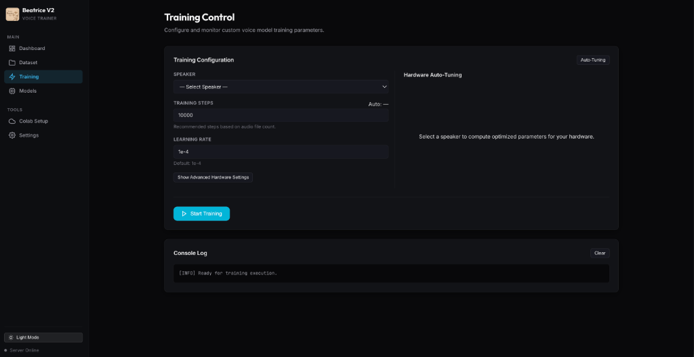

<p align="center">
  
</p>

# Project Beatrice V2 Voice Trainer (macOS Edition)

[-apple?logo=apple&logoColor=white&style=flat-square)](#)
[](#)
[-orange?logo=pytorch&logoColor=white&style=flat-square)](#)
[](#)
[](#)

A high-performance, hardware-aware desktop Web application for training custom real-time voice conversion models using **Project Beatrice V2** on macOS (Apple Silicon M1/M2/M3/M4 & Intel Macs). Featuring a modern **Cyan Blue minimalist UI**, dynamic **Light/Dark theme toggle**, **Single-Choice Dataset Import Selector** (Local Drop-Zone, Hugging Face, Kaggle), automated **Apple Silicon MPS Hardware Tuning**, and direct **Google Colab & Kaggle Cloud Launchpad** integration.

---

## ✨ Key Features

* 💎 **Cyan Blue Minimalist UI & Vector SVGs** — Ultra-sleek Linear/Vercel-inspired desktop design system with custom vector SVG icons and sharp typography (`Inter`, `Outfit`, `JetBrains Mono`).
* 🌓 **Light & Dark Mode Theme Switcher** — Instant theme switching with persistent user preferences stored in local storage (`localStorage`).
* 🎯 **Single-Choice Dataset Import Selector** — Segmented method picker allowing users to easily choose between **Local Audio Upload**, **Hugging Face Import**, or **Kaggle Dataset Import**.
* 🍎 **Apple Silicon MPS Hardware Tuning** — Deep profiling for Apple M1, M2, M3, M4 (Base, Pro, Max, Ultra) using PyTorch Metal Performance Shaders (MPS) and unified memory allocation.
* ☁️ **Cloud Training Launchpad** — Direct integration of `Project-Beatrice-V2/Beatrice-colab` with one-click **Google Colab** (`.ipynb`) and **Kaggle** launch buttons and local notebook downloads.
* 📈 **Real-Time Monitoring & Metrics** — Live loss plotting on HTML Canvas, stdout logging console, and unified RAM/MPS memory usage gauges.

---

## 🖼️ Interface Showcase

<p align="center">
  
  <br><sub><b>Dashboard Overview</b> — Live hardware monitor, memory allocation gauges, and system diagnostics</sub>
</p>

<p align="center">
  
  <br><sub><b>Dataset Manager</b> — Single-choice import selector (Local Audio Drag & Drop, Hugging Face, Kaggle)</sub>
</p>

<p align="center">
  
  <br><sub><b>Training Control</b> — Hardware auto-tuning, custom training steps, and live console logger</sub>
</p>

<p align="center">
  
  <br><sub><b>Cloud Training Launchpad</b> — One-click Google Colab and Kaggle launch cards with local .ipynb downloads</sub>
</p>

---

## ⚡ Quick Start

### 📋 Prerequisites

* **Operating System**: macOS 12 (Monterey) or newer (macOS 13+ recommended for optimal Metal MPS support).
* **Hardware**: Apple Silicon (M1/M2/M3/M4 Base/Pro/Max/Ultra) or Intel Mac.
* **Interpreter**: Python 3.10 or newer (`python3 --version`).

### 💻 One-Click Execution

Open Terminal and execute `start.sh`:

```bash
chmod +x start.sh
./start.sh
```

#### What the Startup Script Automates:
1. Creates a local Python virtual environment (`venv/`).
2. Installs macOS PyTorch with Apple MPS (Metal) backend support.
3. Installs backend dependencies (`fastapi`, `uvicorn`, `python-multipart`, `aiofiles`, `huggingface_hub`, `psutil`).
4. Downloads the core **Beatrice Trainer** repository from Hugging Face (`fierce-cats/beatrice-trainer`).
5. Launches the FastAPI backend server and automatically opens your browser at **`http://localhost:8000`**.

---

## 🎮 macOS Hardware Auto-Tuning Matrix

When selecting a speaker dataset in the **Training** tab, the system profiles Apple Silicon unified memory to compute optimal parameters:

| Apple Silicon / RAM | Unified Memory Budget | Batch Size | Grad Accum | Effective Batch | Workers | Backend |
| :--- | :---: | :---: | :---: | :---: | :---: | :---: |
| **Max / Ultra (36GB+ RAM)** | ~32 GB | 16 | 1 | 16 | 0 | MPS (Metal) |
| **Pro / Max (16GB - 32GB RAM)** | ~12 - 24 GB | 8 | 2 | 16 | 0 | MPS (Metal) |
| **Base Chip (8GB - 16GB RAM)** | ~4 - 12 GB | 4 | 4 | 16 | 0 | MPS (Metal) |
| **Intel / CPU Fallback** | System RAM | 2 | 4 | 8 | 2 | CPU |

---

## 📂 Directory Structure

```text
├── assets/                          # App branding and logo assets
│   └── logo.jpg                     # Official Project Beatrice V2 Logo
├── colab_repo/                      # Cloned Beatrice-Colab repository
│   ├── BeatriceV2_Trainer_Notebook_Colab.ipynb
│   └── BeatriceV2_Trainer_Notebook_Kaggle.ipynb
├── app.js                           # Client-side JavaScript application & UI handlers
├── index.html                       # Modern HTML layout & component views
├── index.css                        # Cyan Blue Design System & Light/Dark themes
├── server.py                        # FastAPI Mac-optimized backend server
├── start.sh                         # Automated macOS shell startup script
├── requirements.txt                 # Backend Python dependencies
├── README.md                        # Product documentation manual
└── beatrice-trainer/                # Downloaded Hugging Face trainer files
```

---

## 🌐 API Endpoint Reference

| Endpoint | Method | Description |
| :--- | :---: | :--- |
| `/api/status` | `GET` | System health check & backend availability |
| `/api/system/memory` | `GET` | Live RAM, MPS GPU, and CPU usage metrics |
| `/api/dataset/list` | `GET` | List available speaker datasets and file counts |
| `/api/dataset/upload` | `POST` | Upload WAV or ZIP audio files |
| `/api/dataset/import/hf` | `POST` | Download dataset directly from Hugging Face |
| `/api/dataset/import/kaggle` | `POST` | Import dataset from Kaggle |
| `/api/train/auto-tune` | `POST` | Compute optimal training hyperparameters |
| `/api/train/start` | `POST` | Launch local model training process |
| `/api/train/stop` | `POST` | Terminate active model training process |
| `/api/models/list` | `GET` | List trained VST3 paraphernalia voice models |

---

## 📄 License

This project is licensed under the [MIT License](LICENSE).
